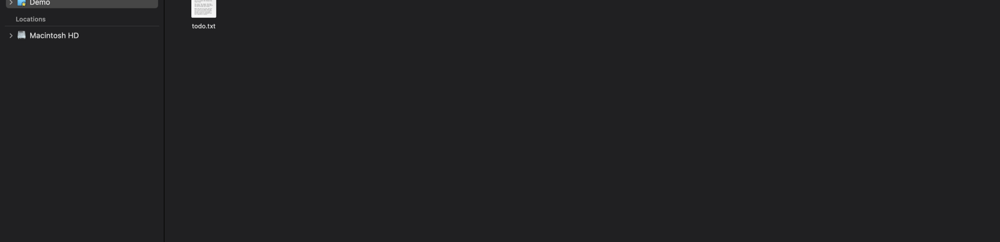
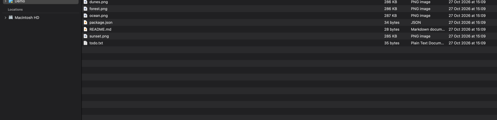
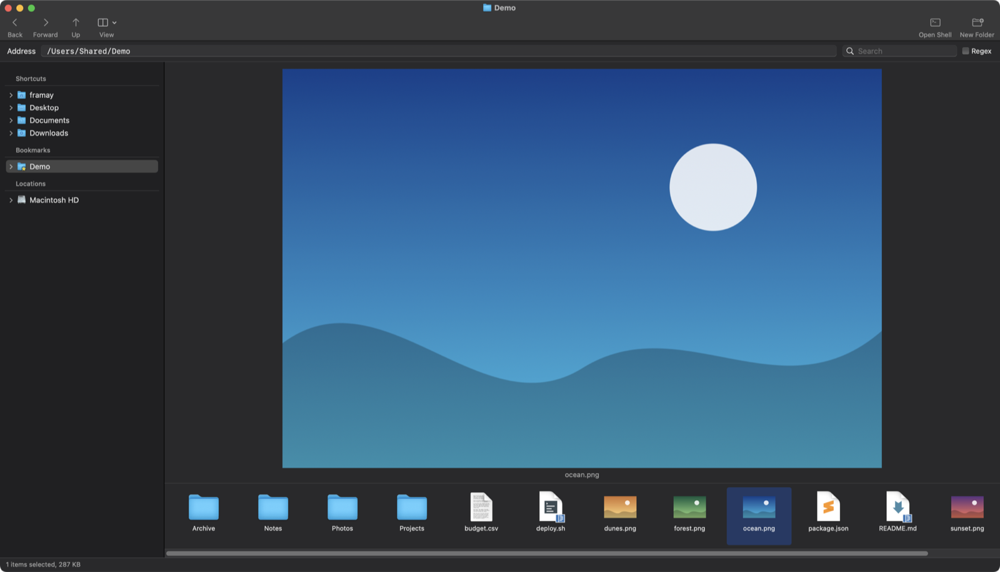
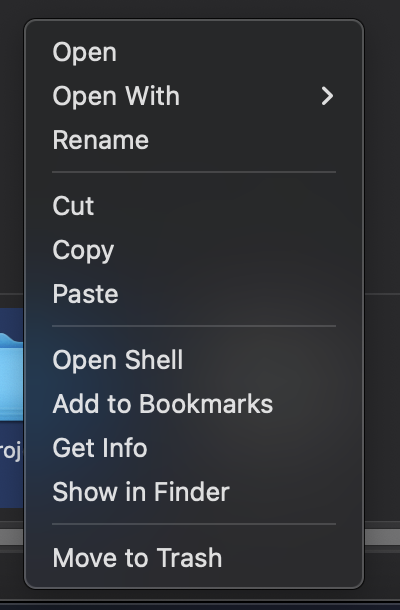

<h1 align="center">🗂️ Explorer</h1>

<p align="center">
  A fast, keyboard-friendly file explorer for macOS, in the spirit of the classic Windows Explorer.<br>
  Folder tree on the left, files on the right, Back / Forward / Up on top.
</p>

<p align="center">
  
  
  
  
  
</p>

<p align="center"></p>

## 🚀 Run it

```bash
make run    # build, install to /Applications, open
make test   # run the core tests
```

Open a specific folder with `Explorer /some/folder`.
Grant **Full Disk Access** to `/Applications/Explorer.app` once, so protected folders open.

## ✨ Features

| | |
|---|---|
| 🌳 **Sidebar** | Shortcuts, **Bookmarks** (⭐ badge on their icons) and Locations. Drives show up when plugged in. |
| 👀 **Three views** | Details, Icons and Preview. The choice is remembered per folder; small folders open as icons. |
| 📏 **Folder sizes** | Calculated in the background and cached in SQLite. |
| 🔎 **Filter** | Search the open folder by name, with optional regex. |
| ⏪ **Smart Back** | Back and Forward restore scroll, selection and filter. Up just goes to the parent. |
| ✏️ **Rename** | Click, pause, click or F2. A popover shows the whole name; Esc cancels. |
| 🖱️ **Direct manipulation** | Marquee selection with live preview, drag to move, cut / copy / paste. |
| 🗑️ **Safe delete** | `X` or `Delete` asks first. Enter confirms. Items go to the Trash. |
| 🧰 **Context menu** | Open With…, Get Info (via Finder), Open Shell (Terminal), Add to Bookmarks. |
| 🙈 **`.explorerignore`** | Hide files with the same format as `.gitignore`. |

<p align="center">
  <br>
  
</p>

<p align="center"></p>

## ⌨️ Shortcuts

| Key | Action | Key | Action |
|---|---|---|---|
| `⌘[` / `⌘]` | Back / Forward | `F2` | Rename |
| `⌘↑` | Up | `X` / `⌫` | Move to Trash |
| `⌘⇧N` | New folder | `⌘I` | Get Info |
| `⌘R` | Refresh | `⌘⇧.` | Show hidden files |

Mouse side buttons also go back and forward. Typing a path in the address bar and pressing Enter opens it.

## 🙈 `.explorerignore`

One file at `~/.explorerignore` applies everywhere. A `.explorerignore` inside a folder applies to that folder and below.

```gitignore
# same syntax as .gitignore
.DS_Store
*.log
build/
!keep.log
```

Press `⌘R` after editing it.

## 🧱 How it is built

- `Sources/ExplorerCore`: folders, history, sorting, sizes, bookmarks, ignore rules. No UI.
- `Sources/Explorer`: the AppKit window, views and menus.
- `Tests/ExplorerCoreTests`: core tests, run with `make test`.

New features usually enter in one place:

- A file operation: `FileActions.swift`, an item in `MainMenu.swift`, and a method in `MainWindowController`.
- A preview format: a new type in `FilePreviews.swift`, added to `providers`.
- A column: `FileItem`, `Sorting.swift` and `FileListController`.
